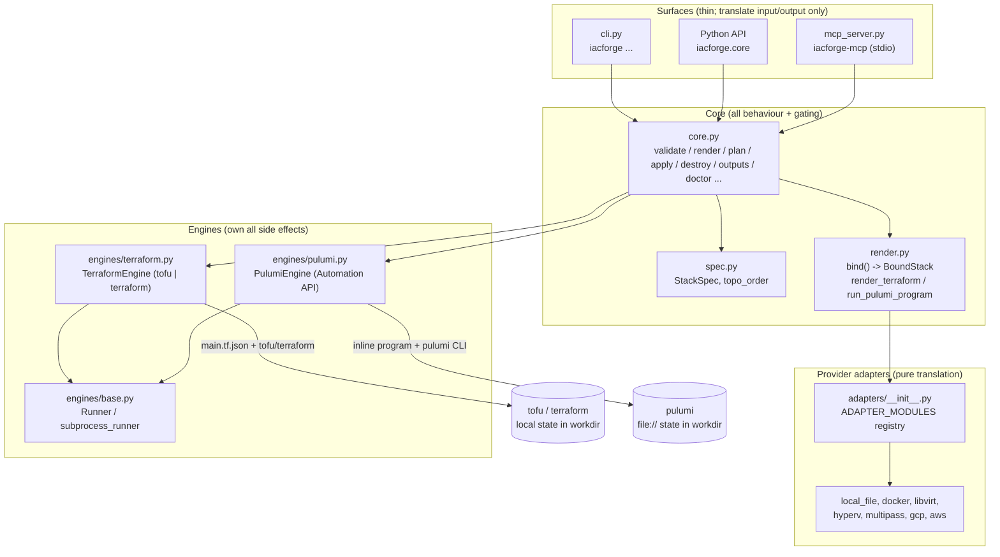
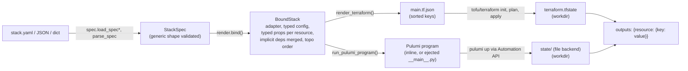
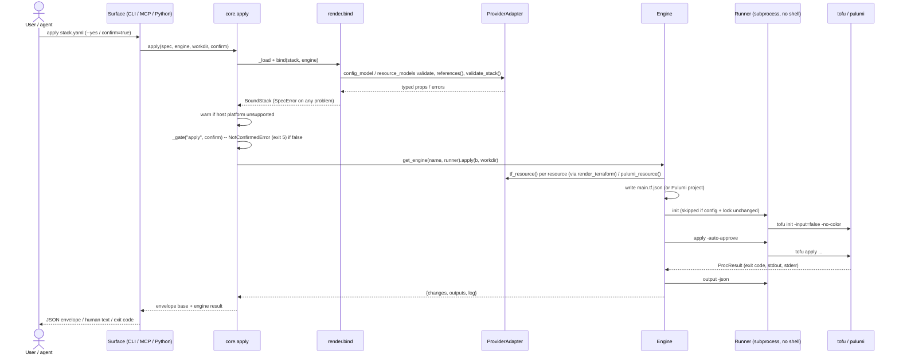

# Architecture

iacforge turns one provider-neutral YAML stack spec into real infrastructure by way of
OpenTofu/Terraform or Pulumi. This page is the map: layers, data flow, modules, invariants and the
error model. Deeper references live in [docs/system/](system/) and the [ADRs](adr/).

## Layers

Dependency direction is strictly downward. Adapters never import engines; engines never branch on
provider names; surfaces never contain behaviour (ADR 0003, ADR 0004).

## Data flow

1. **Parse** (`spec.py`): YAML (a JSON superset) is loaded with `yaml.safe_load` and validated into
   `StackSpec`. Names must match `^[a-z][a-z0-9-]{0,62}$`; `dependsOn` is checked for unknown
   names, self-dependency and cycles (`topo_order`).
2. **Bind** (`render.bind`): look up the adapter, check the engine family is supported, validate
   `providerConfig` and every resource's `properties` against the adapter's pydantic models (all
   `extra="forbid"`), run `adapter.references()` to turn implicit references into `dependsOn`
   edges, run `adapter.validate_stack()` for cross-resource checks, then compute the final topological
   order. All problems are collected into a single `SpecError` with `details=[{path, message}]`.
3. **Render**: `render_terraform` produces the full Terraform JSON document; `run_pulumi_program`
   creates Pulumi resources in dependency order. Both are deterministic.
4. **Execute** (engine): writes files to the workdir, runs the tool through a `Runner`, parses the
   result into `changes` / `outputs`.
5. **State** lives in the workdir (default `<spec dir>/.iacforge/<stack>/<engine>`): Terraform's local
   `terraform.tfstate`, or `state/` for the Pulumi file backend.

## Sequence: `apply`

Note the ordering: the spec is fully validated *before* the confirm gate, so an unconfirmed `apply`
still reports spec errors first, and a `not_confirmed` error proves the spec was valid. Nothing is
written to disk before the gate.

## Module map

Every file under `src/iacforge`:

| File | Purpose |
|---|---|
| `__init__.py` | Package marker; defines `__version__`. |
| `spec.py` | `StackSpec` / `Resource` models, name pattern, `topo_order`, spec loading, JSON Schema export. |
| `errors.py` | `IacForgeError` hierarchy with stable `code` and process `exit_code`. |
| `core.py` | Every operation (version, providers, schema, doctor, validate, render, plan, outputs, apply, destroy, init); owns the confirm gate and workdir resolution. |
| `surfaces.py` | `OPERATIONS` table mapping each core operation to its CLI command and MCP tool (checked by `tests/test_surface_parity.py`). |
| `cli.py` | argparse CLI, `--json` envelope, interactive confirm prompt, exit codes. |
| `mcp_server.py` | One plain-function MCP tool per core operation; lazy FastMCP registration; same envelope as the CLI. |
| `render.py` | `bind()` -> `BoundStack`; `render_terraform`, `terraform_json`, `run_pulumi_program`, `pulumi_opts`, `nest_outputs`. |
| `adapters/__init__.py` | Provider registry (`ADAPTER_MODULES`), lazy import, `get_adapter`, `all_adapters`, `provider_names`. |
| `adapters/base.py` | `ProviderAdapter` contract, `Props`, `TfResult`, `TfContext`, `PulumiResult`, `PulumiContext`, `tf_id`, `output_key`. |
| `adapters/local_file.py` | `local` provider (files): the reference adapter and e2e test target. |
| `adapters/_pulumi_local.py` | Pulumi dynamic provider backing the `local` file resource under the pulumi engine. |
| `adapters/docker.py` | `docker` provider: image, container, network, volume (stable; Terraform + Pulumi). |
| `adapters/libvirt.py` | `libvirt` provider: vm, network, pool, volume (beta; Linux; Terraform + Pulumi). |
| `adapters/hyperv.py` | `hyperv` provider: vm, switch, vhd (beta; Windows only; Terraform only). |
| `adapters/multipass.py` | `multipass` provider: vm (beta; all OSes; Terraform only). |
| `adapters/gcp.py` | `gcp` provider: network, subnet, firewall, vm, bucket, service_account (beta; Terraform + Pulumi). |
| `adapters/aws.py` | `aws` provider: vpc, subnet, security_group, vm, bucket (scaffold; Terraform + Pulumi). |
| `engines/__init__.py` | `get_engine()` factory and `ENGINE_NAMES`. |
| `engines/base.py` | `Engine` base class, `Runner` protocol, `ProcResult`, `subprocess_runner`. |
| `engines/terraform.py` | `TerraformEngine`: writes `main.tf.json`, drives `tofu`/`terraform`, parses plan JSON. |
| `engines/pulumi.py` | `PulumiEngine`: Automation API with a local file backend; renders an ejectable project. |

Outside the package: `tests/` (see [testing](system/testing.md)), `scripts/install.sh` and
`scripts/install.ps1` (install via uv/pipx, then `iacforge doctor`), `.github/workflows/ci.yml`.

## Key invariants

1. **Adapters are pure.** They convert validated models into engine-native structures. No
   subprocesses, no filesystem, no network, no state. (The only I/O-adjacent code in an adapter is
   the lazy import of a Pulumi SDK inside `pulumi_*` methods.)
2. **Engines own side effects.** Every subprocess goes through a `Runner` (default
   `subprocess_runner`, list args, never a shell). Tests inject fakes.
3. **Gating lives in core.** `apply` and `destroy` call `_gate()` and raise `NotConfirmedError`
   unless `confirm=True`. Surfaces cannot bypass it; they only decide how to obtain confirmation.
4. **Rendering is deterministic.** Resources are emitted in topological order with declaration-order
   tie-breaks; `terraform_json` uses `sort_keys=True`; `depends_on` lists are sorted. Same spec in,
   byte-identical `main.tf.json` out. Adapters must not use sets, timestamps or random values.
5. **Validation is strict and total.** Every model is `extra="forbid"`; `bind()` reports all errors
   at once with JSON-path-style `path` values.
6. **One implementation per operation.** Surfaces are tied to core by `surfaces.OPERATIONS` and
   `tests/test_surface_parity.py`.
7. **No credentials in specs.** Provider config carries project/region/profile names, never secrets.
8. **Host differences are metadata.** `platforms`, `required_tools` and `engines` on the adapter,
   not `if platform` branches in core. (`core._bind` only emits a *warning* for unsupported hosts;
   `render` still works.)

### Naming rules

| Thing | Rule | Helper |
|---|---|---|
| Terraform identifier | stack name with every char outside `[A-Za-z0-9_]` replaced by `_`; prefixed `r_` if it would not start with a letter or `_` (`web-1` -> `web_1`) | `adapters.base.tf_id` |
| Primary Terraform address | `<tf_types[type]>.<tf_id(name)>` | `TfContext.address` |
| Extra helper blocks | `<tf_id(name)>_<suffix>` | adapter convention |
| Flat output key | `<tf_id(resource)>__<key>` (double underscore) | `adapters.base.output_key` |
| Nested output | `{resource: {key: value}}`; engines map `tf_id` back to the original stack name | `render.nest_outputs` |
| Pulumi logical name | the stack resource name (as written) | n/a |

## Error model

Every failure is an `IacForgeError` subclass with a stable `code` (agents branch on this) and a
process `exit_code`. `message` is human text and may change; `details` is optional structured data.

| Exception | `code` | Exit | Meaning |
|---|---|---|---|
| (success) | n/a | 0 | `EXIT_OK` |
| `IacForgeError` / unexpected exception | `error` / `internal` | 1 | `EXIT_ERROR`: internal failure. Unhandled exceptions in the CLI and MCP surfaces are reported with code `internal`. |
| `SpecError` | `invalid_spec` | 2 | `EXIT_INVALID`: bad spec, bad CLI usage; `details` is a list of `{path, message}`. Also returned for unreadable spec files. |
| `UnknownProviderError` (subclass of `SpecError`) | `unknown_provider` | 2 | Provider not in the registry; `details.known` lists names. |
| `UnsupportedError` (subclass of `SpecError`) | `unsupported` | 2 | Provider does not support the requested engine (raised by `bind()`). An unknown resource type is a plain `invalid_spec`; an unsupported host OS is only a warning. |
| `ToolMissingError` | `tool_missing` | 3 | `EXIT_TOOL_MISSING`: `tofu`/`terraform`/`pulumi` (or the pulumi Python SDK) not installed; `details.hint` says how to install. |
| `EngineError` | `engine_failed` | 4 | `EXIT_ENGINE`: the engine ran and failed; `details` has `command`, `exit_code`, tail of `stderr`/`stdout`. |
| `NotConfirmedError` | `not_confirmed` | 5 | `EXIT_NOT_CONFIRMED`: `apply`/`destroy` without `--yes` / `confirm=true`. |

Other exit paths: `KeyboardInterrupt` exits 2 in the CLI; `iacforge-mcp` exits 3 if the `mcp`
package is not installed.

Both machine surfaces share one envelope: success `{"ok": true, "command": "...", "data": {...}}`,
failure `{"ok": false, "command": "...", "error": {"code", "message", "details"?}}`. The CLI emits it
with `--json` or `IACFORGE_OUTPUT=json`; MCP tools always return it. Error codes and exit codes are
a public contract; changing them is a breaking change (ADR 0004).

## Related

- [Contracts](system/contracts.md), [adding a provider](system/adding-a-provider.md),
  [engines](system/engines.md), [testing](system/testing.md), [security](system/security.md),
  [GCP plan](system/gcp-plan.md), [roadmap](ROADMAP.md).
